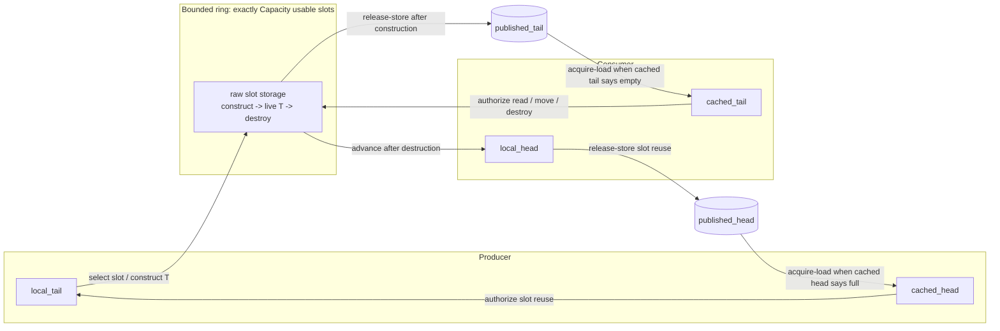

# VeriQueue

> Header-only C++20 bounded SPSC queue with a wait-free synchronization/control path and a verification-first concurrency laboratory.

VeriQueue is a deliberately small single-producer/single-consumer FIFO queue surrounded by an unusually large falsification apparatus.

The queue is fixed-capacity, allocation-free on the hot path, uses raw object storage, cached remote cursors, cache-line-separated control state, and only acquire/release synchronization. Its synchronization/control path contains no retry loop whose completion depends on another thread: for valid SPSC use, that path is **wait-free**. End-to-end operation latency can still depend on user-supplied constructors, moves, assignments, callbacks, and destructors.

> Design rule: keep the concurrent primitive minimal; make the attempt to falsify it enormous.

## What is implemented

- C++20 header-only `spsc_queue<T, Capacity, CacheLine, Index>`; CI also qualifies C++23 consumers.
- Power-of-two bounded ring with exactly `Capacity` usable slots.
- Preallocated storage, no mutexes, and no CAS/RMW in the queue hot path.
- Producer/consumer private cursors with cached remote indices.
- Release publication of constructed elements and consumed slots; acquire observation on the opposite side.
- Scalar push/emplace/pop, batched push/pop, and callback-based consume APIs.
- Forced `uint8_t` / `uint16_t` rollover tests using the production algorithm.
- Deterministic lifetime, boundary, move-only, alignment, and exception tests.
- Independent `std::deque` reference model and exhaustive small-state testing.
- Concurrent monotonic-ID stress with burst/jitter perturbations.
- ASan/UBSan and TSan CI lanes.
- libFuzzer targets for semantic, lifetime, and wraparound fuzzing.
- Relacy weak-memory model with a pinned dependency revision.
- Porcupine-based independent linearizability checker plus HTML visualization support.
- Mutation campaign catalogue and verifier-effectiveness ledger.
- Affinity-aware custom benchmark harnesses, raw JSONL output, environment capture, latency percentiles, and analysis tooling.
- Separate evidence and research directories so claims can point at preserved artifacts rather than prose.

## Architecture and memory flow



The producer is the sole writer of its local tail and cached head; the consumer is the sole writer of its local head and cached tail. Cross-thread communication is restricted to `published_tail` and `published_head`. Both sides normally operate from cached remote cursors and perform the peer acquire load only on the corresponding empty/full slow path. See [`docs/ARCHITECTURE.md`](docs/ARCHITECTURE.md) and [`docs/MEMORY_MODEL.md`](docs/MEMORY_MODEL.md).

## API

```cpp
#include <veriqueue/spsc_queue.hpp>

veriqueue::spsc_queue<int, 1024> q;

q.try_push(42);

int value = 0;
if (q.try_pop(value)) {
    // value == 42
}
```

Production surface:

```cpp
template<class... Args> bool try_emplace(Args&&... args);
bool try_push(const T& value);
bool try_push(T&& value);
std::size_t try_push_bulk(std::span<const T> values) noexcept;
bool try_pop(T& output) noexcept;   // requires nothrow move assignment
std::size_t try_pop_bulk(std::span<T> output) noexcept;
template<class F> bool try_consume(F&& consumer) noexcept;
bool empty() const noexcept;        // advisory concurrent observation
std::size_t capacity() const noexcept;
std::size_t size_approx() const noexcept; // advisory; always <= capacity()
```

`try_push_bulk()` requires nothrow copy construction. `try_pop_bulk()` requires nothrow move assignment. `try_consume()` requires a nothrow callback. All successful consuming paths destroy the consumed object before publishing slot reuse.

`T` must be nothrow destructible because successful consuming paths and queue destruction destroy live elements on `noexcept` paths. The destructor also requires **external quiescence**: no producer or consumer operation may overlap queue destruction. See [`docs/API_CONTRACT.md`](docs/API_CONTRACT.md) for the complete production contract.

## Build and test

The public library target requires C++20 or newer. Normal CI compiles and tests the production surface under both C++20 and C++23 with GCC and Clang.

```bash
cmake --preset dev
cmake --build --preset dev
ctest --preset dev
```

Sanitizers:

```bash
cmake --preset asan-ubsan
cmake --build --preset asan-ubsan
ctest --preset asan-ubsan

cmake --preset tsan
cmake --build --preset tsan
ctest --preset tsan
```

Relacy:

```bash
cmake -S . -B build/relacy -G Ninja -DVERIQUEUE_BUILD_RELACY=ON
cmake --build build/relacy --target spsc_relacy
./build/relacy/spsc_relacy
```

Linearizability laboratory:

```bash
cmake -S . -B build/lin -G Ninja -DVERIQUEUE_BUILD_LINEARIZABILITY=ON
cmake --build build/lin --target history_generator
./build/lin/history_generator history.json 123
cd verify/linearizability
go run . ../../history.json ../../history.html
```

Fuzz smoke:

```bash
CC=clang CXX=clang++ cmake -S . -B build/fuzz -G Ninja \
  -DVERIQUEUE_BUILD_TESTS=OFF -DVERIQUEUE_BUILD_STRESS=OFF \
  -DVERIQUEUE_BUILD_FUZZERS=ON
cmake --build build/fuzz
./build/fuzz/fuzz_model -max_total_time=30 fuzz/corpus
```

## Why the synchronization works

Producer publication:

1. construct `T` in the selected slot;
2. advance producer-private tail;
3. release-store the published tail.

Consumer observation:

1. acquire-load the published tail when its cached tail says empty;
2. access/move/destroy the element only after observing publication.

Slot reuse is symmetric: consumer destroys the object before release-publishing head; producer only reuses a slot after an acquire observation of that head.

Bulk operations process a bounded batch and publish the resulting cursor once after the batch. `try_consume()` invokes the callback and destroys the object before release-publishing the advanced head.

The queue deliberately contains no `seq_cst` operation and no explicit fence. See [`docs/MEMORY_MODEL.md`](docs/MEMORY_MODEL.md).

## Progress claim

For valid SPSC use, queue synchronization/control logic for scalar, bulk, and callback operations executes a statically bounded sequence of local operations and at most one remote acquire load on the slow path. It does not spin waiting for the peer. That control path is wait-free.

This statement does **not** imply that arbitrary `T` construction/move/destruction or callback code is wait-free. See [`docs/PROGRESS_GUARANTEE.md`](docs/PROGRESS_GUARANTEE.md).

## Benchmark discipline

No universal "fastest queue" claim is made. Performance claims belong to evidence produced with explicit machine topology, affinity, compiler, workload, payload, capacity, and repetitions.

```bash
cmake --preset release
cmake --build --preset release
python3 tools/run_bench.py --repetitions 20
python3 tools/analyze_bench.py evidence/benchmarks/raw.jsonl
```

The benchmark system is designed to preserve negative results and topology sensitivity. See [`docs/BENCHMARK_METHODOLOGY.md`](docs/BENCHMARK_METHODOLOGY.md), [`docs/BASELINES.md`](docs/BASELINES.md), and the current [`performance qualification protocol`](docs/PERFORMANCE_QUALIFICATION.md).

## Evidence and research history

Current verification and benchmark claims are tracked in [`docs/EVIDENCE_LEDGER.md`](docs/EVIDENCE_LEDGER.md). Machine-generated or deliberately frozen evidence belongs under [`evidence/`](evidence/). Dated benchmark captures, validation snapshots, and historical optimization/protocol records that are useful for reproducing the research path live under [`research/`](research/).

Historical PR numbers, campaign labels, and prior claim language are retained only inside dated research records where they identify the experiment that produced the evidence. They are not current product milestones or performance claims.

## Scope and limitations

This is SPSC v1. It intentionally does not implement blocking waits, dynamic resizing, MPSC/MPMC, coroutines, persistence, cross-process sharing, or allocator abstraction. Bulk operations are bounded fixed-capacity operations rather than a dynamic-resizing facility. `empty()` and `size_approx()` are advisory under concurrency; `size_approx()` nevertheless remains within the physical range `[0, capacity()]`. Queue destruction is not concurrent-safe. Baseline benchmark comparisons must be generated on the target machine before comparative README claims are added.

The evidence ledger is the source of truth for what has actually been established: [`docs/EVIDENCE_LEDGER.md`](docs/EVIDENCE_LEDGER.md).

## License

Apache-2.0. See [`LICENSE`](LICENSE).
